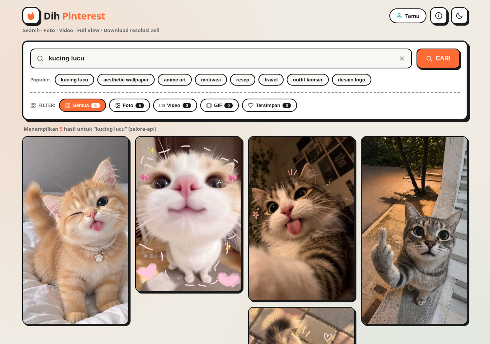
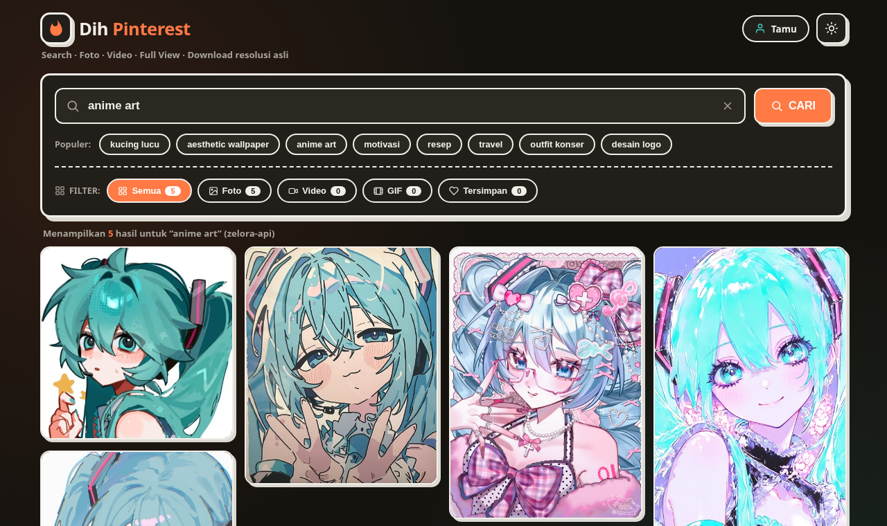
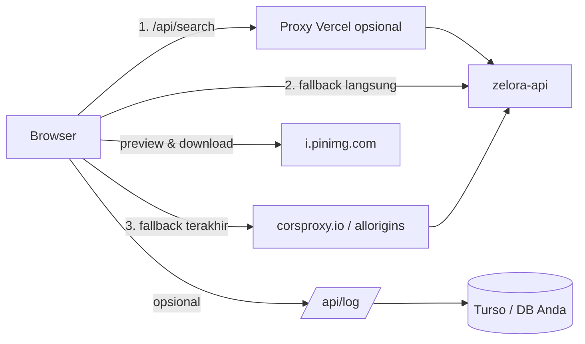
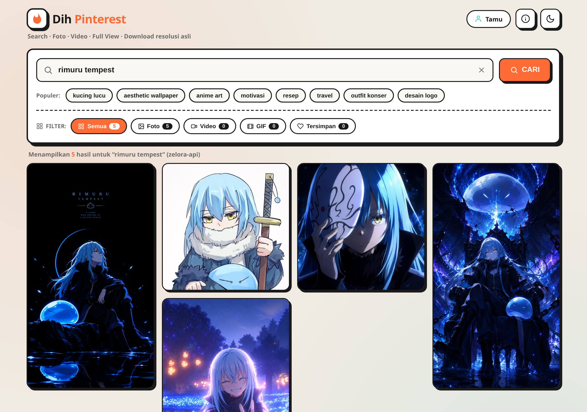
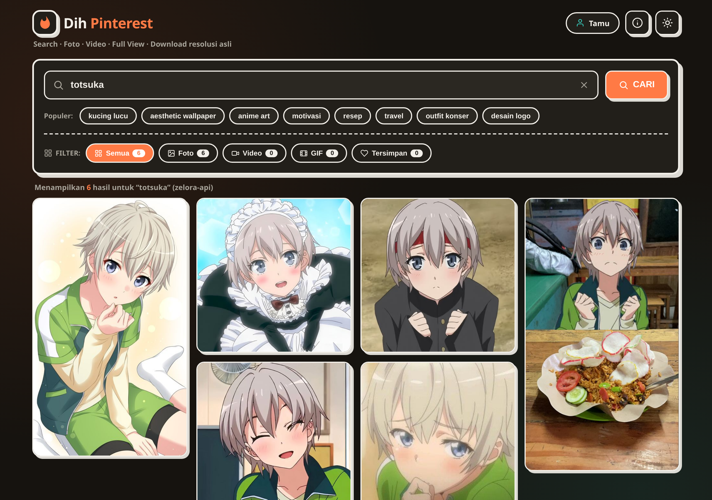
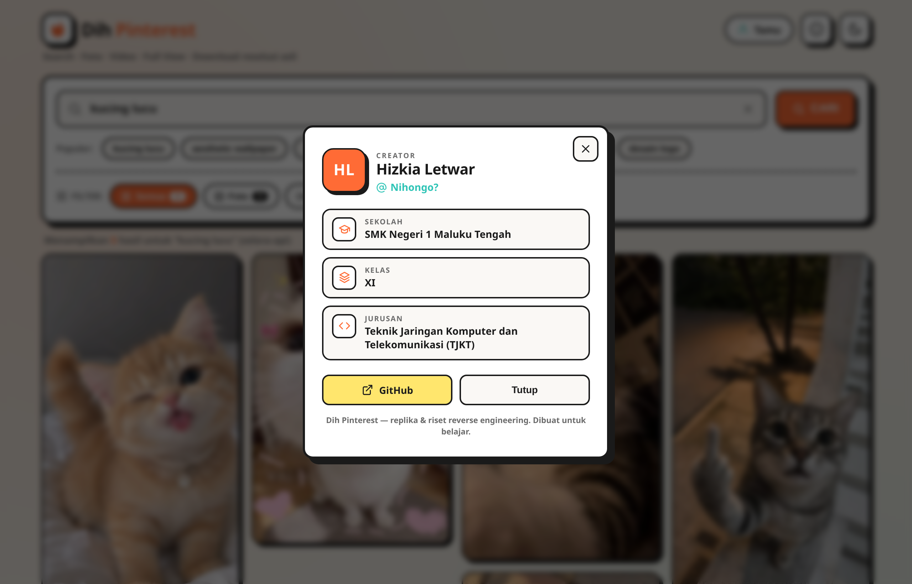

<div align="center">

# 🔥 Dih Pinterest

**Pencarian foto & video Pinterest — statis, cepat, dan jalan di GitHub Pages.**

Replika modern sekaligus **laporan reverse engineering** dari `searchpinterest.vercel.app`.

[](https://ikyletwar.github.io/dih-pinterest-replica/)
[](LICENSE)
[](#-arsitektur)
[](#-deploy)

**🚀 Demo:** <https://ikyletwar.github.io/dih-pinterest-replica/>


<br>


</div>

---

## Daftar isi

- [Fitur](#-fitur)
- [Arsitektur](#-arsitektur)
- [Galeri hasil pencarian](#-galeri-hasil-pencarian)
- [Cara pakai](#-cara-pakai)
- [Deploy](#-deploy)
- [Hasil reverse engineering (laporan)](#-hasil-reverse-engineering-laporan)
  - [Cloaking zero-width](#1-cloaking-zero-width-chars)
  - [Temuan keamanan](#2-temuan-keamanan-pada-situs-asli)
- [Perbedaan dengan situs asli](#-perbedaan-dengan-situs-asli)
- [Struktur proyek](#-struktur-proyek)
- [Roadmap](#-roadmap)
- [Creator](#-creator)
- [Lisensi](#-lisensi)

---

## ✨ Fitur

| Fitur | Keterangan |
|---|---|
| 🔍 **Pencarian Pinterest** | Ambil hasil dari API pencarian publik, render langsung di browser |
| 🧱 **Masonry asli** | Kolom responsif (CSS multi-column), tinggi mengikuti rasio asli media |
| 🖼️ **Lightbox** | Pratinjau layar penuh + navigasi keyboard (`←` `→` `Esc`) + counter |
| ⬇️ **Download resolusi asli** | Otomatis upgrade `i.pinimg.com/474x/...` → `/originals/...` |
| ❤️ **Tersimpan (favorit)** | Simpan pin di `localStorage`, tersedia sebagai filter tersendiri |
| 🎛️ **Filter tipe** | Semua / Foto / Video / GIF + badge jumlah per kategori |
| 🌗 **Mode gelap** | Toggle manual, tersimpan, mengikuti `prefers-color-scheme` |
| 🧠 **Riwayat pencarian** | 10 query terakhir, bisa dibersihkan, muncul saat input difokuskan |
| ♾️ **Progressive render** | Kartu dirender per 16 item saat mendekati viewport (IntersectionObserver) |
| 🔗 **Deep link** | `?nama=Tamu&q=kucing&theme=dark` — bisa dibagikan langsung |
| 👤 **Menu creator** | Profil pembuat proyek (identitas sekolah & jurusan), bisa dibuka dari topbar atau footer |
| 🛡️ **Anti-CORS berlapis** | Proxy sendiri → API langsung → proxy publik (fallback otomatis) |
| ♿ **Aksesibilitas** | Landmark, `aria-*`, fokus terlihat, dukungan `prefers-reduced-motion` |
| 📦 **Nol dependensi frontend** | Tanpa framework, tanpa CDN ikon (SVG sprite inline), tanpa build step |

---

## 🧩 Arsitektur



**Tanpa build step.** Frontend murni HTML + CSS + JS:
`index.html` → `assets/css/style.css` → `assets/js/app.js`.

Logika pencarian memakai **rantai fallback tiga lapis**, sehingga satu kode yang sama
berfungsi di GitHub Pages (statis), Vercel (serverless), maupun `file://`:

1. `/api/search` — proxy server-side (hanya bila di-deploy ke Vercel).
2. `https://zelora-api.vercel.app/search/pinterest` — langsung dari browser.
3. `corsproxy.io` → `allorigins.win` — proxy publik, dipakai bila CORS gagal.

Status sumber data ditampilkan di UI, mis. `(zelora-api)` atau `(proxy-sendiri)`.

---

## 🖼️ Galeri hasil pencarian

Contoh nyata hasil pencarian di app (bukan mockup) — screenshot diambil langsung dari
[halaman live](https://ikyletwar.github.io/dih-pinterest-replica/) memakai headless Chromium.

### ⚔️ “rimuru tempest”



*Mode terang · 5 hasil · filter Foto aktif · sumber data `zelora-api`.*

### 🌸 “totsuka”



*Mode gelap · 6 hasil · masonry responsif mengikuti rasio asli tiap media.*

---

## 🚀 Cara pakai

### Lokal (30 detik)

```bash
git clone https://github.com/ikyletwar/dih-pinterest-replica.git
cd dih-pinterest-replica
python3 -m http.server 8080
# buka http://localhost:8080
```

Tidak perlu `npm install`, tidak perlu build. Endpoint `/api/*` otomatis tidak
dipakai saat statis; app langsung memakai API publik.

### Deep link

```
index.html?nama=Tamu&q=kucing%20lucu&theme=dark
```

---

## ☁️ Deploy

### GitHub Pages (statis)

Repo ini sudah disiapkan untuk Pages: **Settings → Pages → Source: `Deploy from a branch` → `main` / `root`**.
File `.nojekyll` sudah disertakan agar aset disajikan apa adanya.

### Vercel (statis + proxy serverless)

```bash
npm i -g vercel
vercel --prod
```

Dengan Vercel, proxy `/api/search`, `/api/download`, dan `/api/dl` aktif:

| Endpoint | Fungsi | Pengamanan |
|---|---|---|
| `GET /api/search?q=&limit=` | Proxy pencarian | Timeout 12s, `limit` di-clamp 1–100, cache 60s |
| `GET /api/download?url=` | Resolusi penuh + metadata pin | Wajib URL `*.pinterest.*` / `pin.it`, timeout 15s |
| `GET /api/dl?url=` | Proxy blob media | **Allowlist host**, tolak IP/privat, maks 32 MB, rate limit 120/menit |
| `POST /api/log` | Logging opsional ke DB sendiri | Rate limit 60/menit, sanitasi input, 501 bila env kosong |

Logging **nonaktif secara default**. Untuk mengaktifkan (opsional), set env var:

```bash
TURSO_URL=https://<db>-<org>.turso.io
TURSO_TOKEN=<token-turso-anda>
```

Skema tabel dibuat otomatis (`users`, `searches`).

---

## 🔬 Hasil reverse engineering (laporan)

Situs target: `searchpinterest.vercel.app`. Yang dianalisis: struktur hosting,
mekanisme cloaking, alur data, dan permukaan risiko.

### Alur asli

```
Browser
 ├─ GET /                     → HTML "Rapwy is Here" (konten asli disembunyikan)
 │    └─ <script> decode zero-width → document.write(app.html)
 ├─ POST /v2/pipeline         → database Turso (log join/search)
 ├─ GET  api.ipify.org        → ambil IP publik pengunjung
 └─ GET  /search/pinterest    → data via zelora-api (fallback corsproxy/allorigins)
```

### 1. Cloaking zero-width chars

Konten asli **tidak pernah ada** di respons HTTP:

```
HTML asli → btoa(base64) → tiap bit jadi karakter tak terlihat
           0 = U+200B (ZWSP), 1 = U+200C (ZWNJ)
        → ~212.000 karakter tersembunyi di dalam template literal
        → browser: zwToBinary → binaryToBase64 → atob → document.write
```

Akibat: crawler, scanner, dan reviewer hanya melihat judul + skrip kecil.
Yang tampil di browser (setelah JS berjalan) adalah aplikasi lengkap.

Artefak reproduksi encoder/decoder ada di [`cloak/`](cloak/):

```bash
node cloak/decode.mjs sample_cloaked.html   # decode → HTML asli ke stdout
node cloak/encode.mjs index.html            # encode → HTML berisi ZWSP/ZWNJ
```

> ⚠️ Cloaking **tidak dipakai** di app ini. Trade-off-nya serius: SEO mati,
> aksesibilitas rusak, halaman kosong tanpa JS, dan dianggap praktik mencurigakan
> oleh platform. Folder `cloak/` murni artefak riset dari hasil analisis.

### 2. Temuan keamanan pada situs asli

| # | Temuan | Dampak |
|---|---|---|
| 1 | Token database **read-write** di-hardcode di JavaScript sisi klien | Siapa pun dapat membaca seluruh tabel (nama pengunjung, IP, user-agent, riwayat query) dan menulis/mengubah/menghapus data |
| 2 | PII dikumpulkan tanpa consent memadai (nama + IP via `api.ipify.org` + UA + query) | Pelanggaran privasi pengunjung |
| 3 | Seluruh logika di client, server tidak jadi tameng | Token & endpoint andalan dapat disalahgunakan pihak lain |
| 4 | Ketergantungan penuh pada API pihak ketiga tanpa SLA | Situs lumpuh bila upstream down |

**Mitigasi yang diterapkan di repo ini:**

- Tidak ada satu pun kredensial di frontend; DB hanya lewat env var server-side.
- Logging bersifat opt-in dan mati secara default.
- Endpoint proxy dibatasi (allowlist host, penolakan IP privat, batas ukuran, rate limit).
- IP tidak pernah dicatat oleh frontend kecuali Anda mengaktifkan backend sendiri.
- Nama hanya disimpan di cookie perangkat sendiri (`dih_nama`, SameSite=Lax).

### 3. Endpoint zelora-api (lapisan data pihak ketiga yang dipakai)

```
/download/{youtube,tiktok,capcut,instagram,twitter,facebook,spotify,pinterest,pixiv,...}
/search/{lyrics,npm,pinterest,youtube,spotify,wallpaper,resepkoki}
/tools/{bypass,removebg,shorturl,translate,ssweb,web2zip,iplookup,...}
/ai/{copilot,zelora,imagine,venice}  /game/*  /info/*  /news/*  /random/*  /canvas/*
```

Catatan teknis: `/search/pinterest` mengembalikan thumbnail **474px**; resolusi penuh
(`/originals/`) hanya lewat `/download/pinterest` per pin. App ini memakai trik
upgrade URL `/474x/` → `/originals/` agar tombol download tetap memberi hasil
kualitas penuh tanpa request tambahan.

---

## 🔄 Perbedaan dengan situs asli

| Aspek | Situs asli | Repo ini |
|---|---|---|
| Hosting | Vercel + serverless | Statis (GitHub Pages) **dan** Vercel opsional |
| Cloaking | ZWSP/ZWNJ | Tidak dipakai (transparan, indexable, accessible) |
| Database | Token rw hardcoded di client | Env var server-side, opt-in, default mati |
| Data pribadi | Nama + IP + UA + query dicatat | Hanya nama di cookie lokal (IP opsional & opt-in) |
| Proxy media | Open proxy | Allowlist host + batas ukuran + rate limit |
| Frontend | 1 file monolitik | Dipisah (`index.html` / `style.css` / `app.js`), CSP |
| Framework | Tanpa build | Tanpa build juga 🙂 |

---

## 📁 Struktur proyek

```
dih-pinterest-replica/
├── index.html              # Markup + SVG sprite ikon
├── assets/
│   ├── css/style.css       # Tema terang/gelap, masonry, lightbox
│   ├── js/app.js           # Logika app (search, filter, simpan, download)
│   ├── favicon.svg
│   └── site.webmanifest
├── api/                    # Serverless functions (Vercel)
│   ├── _shared.js          # Utilitas: allowlist, rate limit, timeout
│   ├── search.js           # Proxy pencarian
│   ├── download.js         # Resolusi penuh + metadata pin
│   ├── dl.js               # Proxy blob media (allowlist)
│   └── log.js              # Logging opsional ke DB sendiri
├── cloak/                  # Artefak riset: encoder/decoder zero-width
│   ├── encode.mjs
│   └── decode.mjs
├── docs/                   # Screenshot untuk README
├── vercel.json             # Header keamanan + cache
└── LICENSE                 # MIT
```

---

## 🗺️ Roadmap

- [ ] Infinite scroll ke halaman berikutnya (butuh pagination upstream)
- [ ] Ekspor/impor koleksi "Tersimpan" sebagai JSON
- [ ] PWA offline cache untuk pin yang sudah dibuka
- [ ] Service worker + shell cache untuk buka instan
- [ ] Opsi scraper sendiri (RSS Pinterest) sebagai pengganti API pihak ketiga

---

## 👤 Creator

<div align="center">

</div>

| | |
|---|---|
| **Nama** | Hizkia Letwar |
| **Username** | Nihongo? |
| **Sekolah** | SMK Negeri 1 Maluku Tengah |
| **Kelas** | XI |
| **Jurusan** | Teknik Jaringan Komputer dan Telekomunikasi (TJKT) |
| **GitHub** | [@Ikyletwar](https://github.com/Ikyletwar) |

Menu creator dapat dibuka lewat tombol **ⓘ** di topbar atau tautan nama pada footer.
Isinya dirender sebagai modal dengan `role="dialog"`, `aria-modal`, tombol tutup,
klik backdrop, dan `Esc`.

---

## ⚖️ Lisensi & catatan

MIT — lihat [LICENSE](LICENSE).

Repo ini dibuat untuk **edukasi, riset keamanan, dan interoperabilitas**. Semua
merek dagang milik pemegangnya masing-masing. Media yang ditampilkan berasal dari
layanan pihak ketiga; hormati hak cipta pemilik karya dan ketentuan layanan yang berlaku.
Jangan menyimpan atau mendistribusikan ulang media tanpa izin pemiliknya.
